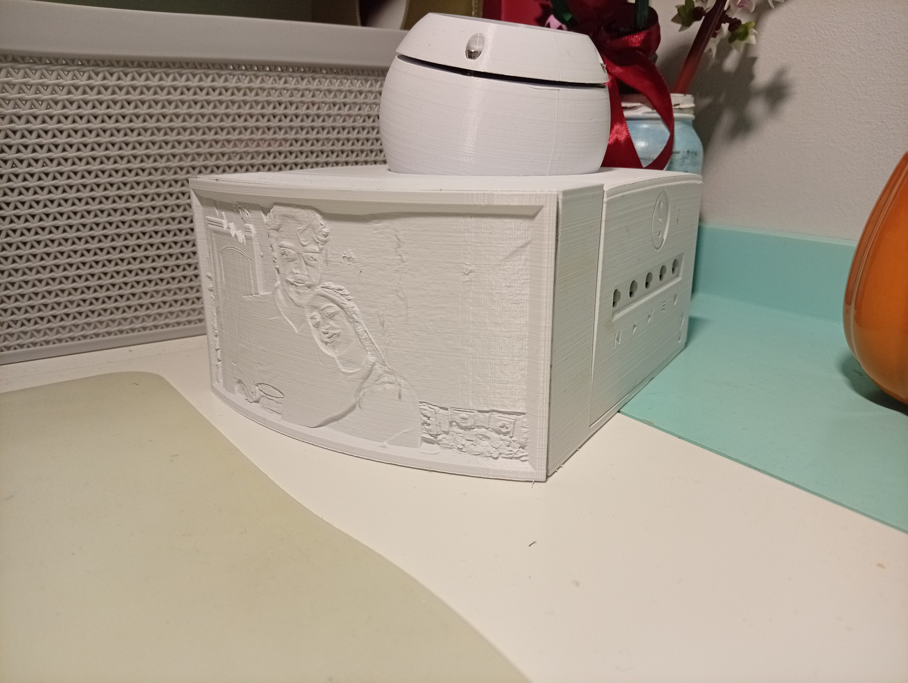
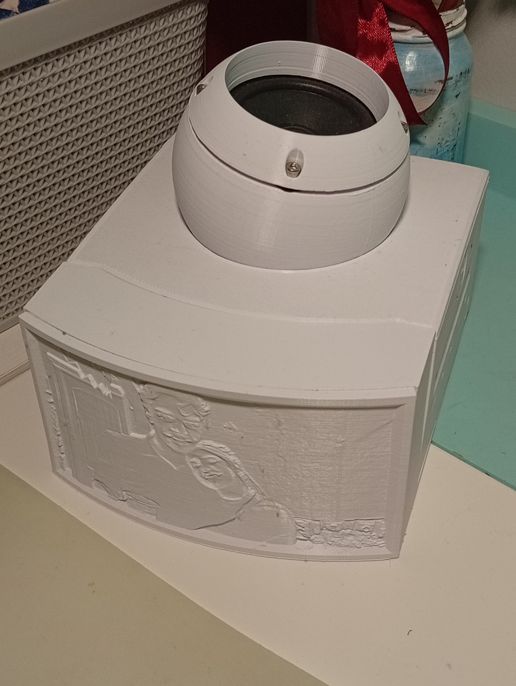
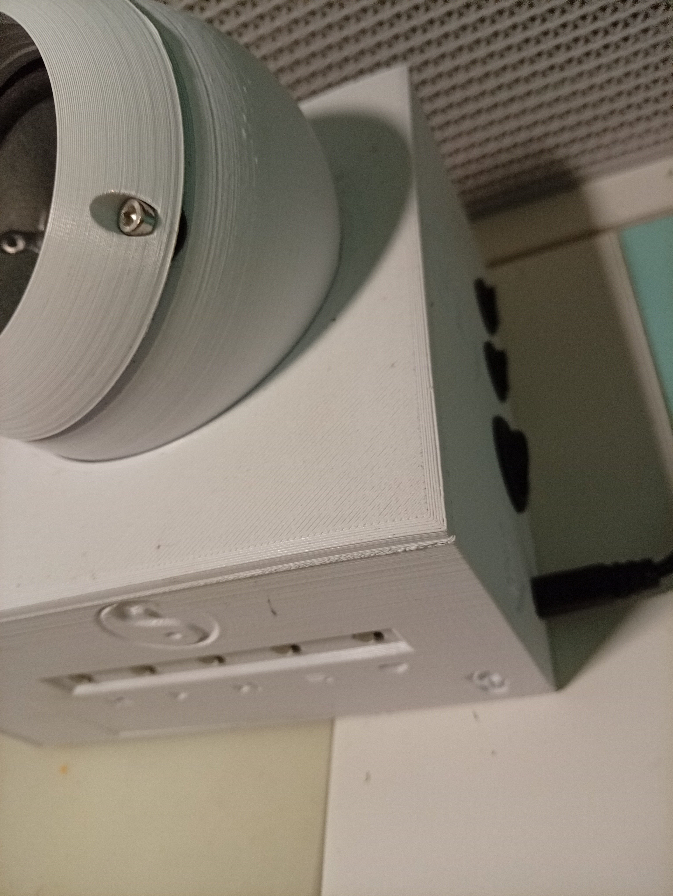
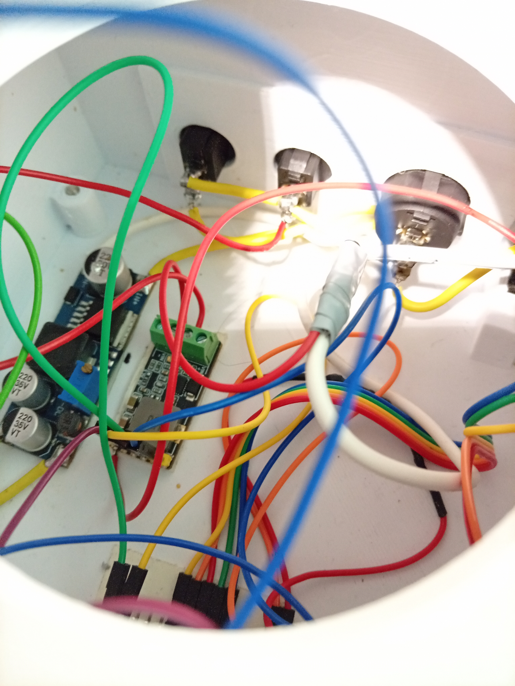

# Smart Lithophane Music Box 🎶💡

A custom-designed, 3D-printed **Lithophane Music Box** built from scratch, combining **CAD design (Fusion 360)**, **embedded C++ firmware (Arduino Mini)**, and **analog audio electronics**. It features a curved, dimmable backlit lithophane display, a top-mounted spherical speaker housing, and a multi-playlist MP3 player with persistent EEPROM storage.



---

## ✨ Key Features

### 1. Mechanical & Optical Design (Fusion 360)
* Designed the entire multi-part enclosure from scratch in **Autodesk Fusion 360** for 3D printing (`.stl` files included in `/cad`), including a curved front lithophane slot, embossed side button icons, and a spherical top speaker mount.
* **Backlight Diffusion:** Lined the interior of the front lithophane chamber with **reflective aluminum tape** behind a white LED strip to maximize brightness and ensure even light distribution.

### 2. Embedded Firmware (Arduino Mini + DFPlayer)
* **Raw UART Serial Protocol:** Communicates directly with the DFPlayer Mini via a custom **10-byte serial command frame with checksum calculation** (no external DFPlayer library used), and parses incoming `0x3D` feedback packets for automatic track advancement.
* **Multi-Function 5-Button Interface:**
  * **Play / Pause:** Toggles audio playback.
  * **Next / Previous:** Short press to skip tracks (with folder wrap-around); **long press (>500ms)** to smoothly increase/decrease volume.
  * **Folder / Playlist Switcher:** Cycles through structured playlists (`01`, `02`, etc.) stored on the DFPlayer.
  * **Favorites Button (Time-Based Multi-Action):**
    * *Short press:* Plays through the saved Favorites list.
    * *Hold (>5 seconds):* Saves the currently playing track to Favorites (with a brief 200ms pause/resume audio confirmation).
    * *Hold (>15 seconds):* Wipes the entire Favorites list.
* **EEPROM Persistence & Usage Tracking:**
  * Stores the Favorites list using a **C++ `struct` circular buffer** (`MAX_FAVS = 5`) in non-volatile EEPROM, alongside the last played volume, folder, and track.
  * Uses `EEPROM.update()` to minimize flash wear.
  * Includes a **10-minute session tracker** that logs valid listening sessions to EEPROM.

### 3. Hardware Challenge & Custom LM741 Amplifier 🔧
* **The Problem:** During testing, the DFPlayer's built-in speaker amplifier burned out.
* **The Solution:** Instead of waiting for a replacement module, I designed and built a **custom analog audio amplifier circuit** using a spare **LM741 op-amp** to drive the top-mounted speaker reliably.

---

## 🔌 Wiring & Pinout

### Arduino Mini Pinout
| Arduino Pin | Connected To | Notes |
| :--- | :--- | :--- |
| `D2` | Next / Volume Up Button | Active LOW (`INPUT_PULLUP`) |
| `D3` | Play / Pause Button | Active LOW (`INPUT_PULLUP`) |
| `D4` | Previous / Volume Down Button | Active LOW (`INPUT_PULLUP`) |
| `D5` | Folder / Playlist Switch Button | Active LOW (`INPUT_PULLUP`) |
| `D6` | Favorites Button | Active LOW (`INPUT_PULLUP`) |
| `D10` | DFPlayer `TX` | `SoftwareSerial` RX (9600 baud) |
| `D11` | DFPlayer `RX` | `SoftwareSerial` TX (1kΩ series resistor recommended) |
| `GND` | Common Ground | Shared across Arduino, DFPlayer, buttons, and amp |

### Power & Audio Architecture
* **Main Power Input** → **Master Toggle Switch** (rear panel) splits power into two independent branches:
  1. **Lighting Branch:** Toggle Switch → Potentiometer (analog dimmer) → White LED Strip (backed with reflective aluminum tape).
  2. **Audio & Logic Branch:** Toggle Switch → Voltage Regulation → **Arduino Mini** + **DFPlayer Mini**.
* **Audio Path:** DFPlayer DAC output → **Custom LM741 Op-Amp Amplifier** → Top-mounted Speaker.

---

## 📸 Build Gallery

| Speaker Mount | Rear Switches & Side Controls | Internal Wiring |
| :---: | :---: | :---: |
|  |  |  |

---

## 🛠️ Hardware & Tech Stack
* **Microcontroller & Firmware:** Arduino Mini, C/C++, Raw UART Protocol, `EEPROM`, `SoftwareSerial`
* **Audio:** DFPlayer Mini, Custom LM741 Op-Amp Amplifier, Speaker
* **Lighting & Power:** White LED Strip, Reflective Aluminum Tape, Potentiometer, 3x Toggle Switches, Buck Converter
* **CAD & Fabrication:** Autodesk Fusion 360, 3D Printing (STL)

---

## 📂 Repository Structure
```text
├── cad/         # 3D printable STL files designed in Fusion 360
├── firmware/    # Arduino Mini C++ source code (lithophane_music_box.ino)
└── assets/      # Photos of the enclosure, controls, and internal wiring
